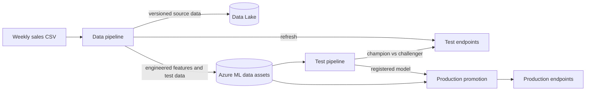

# Azure ML CI/CD pipeline: weekly Walmart sales forecasting

This project implements an automated Azure Machine Learning pipeline that predicts the following week's sales for each Walmart store from the current week's engineered features. As new sales figures become available each week, the pipeline processes and validates the latest data, updates the engineered features, trains and evaluates new candidate models, and deploys an updated model when it performs better than the current one. The result is a repeatable end-to-end workflow that keeps weekly sales forecasts accurate and up to date.

## Highlights

- **End-to-end MLOps on Azure ML**: data versioning in Azure Data Lake Storage, feature engineering with an Azure ML managed feature store (or an Azure ML job when it is unavailable), XGBoost training, champion–challenger evaluation, and real-time and batch endpoints.
- **Separate test and production environments**: models and data are promoted between Azure ML workspaces at matching version numbers.
- **Safe deployments**: every new deployment is smoke-tested before it receives traffic, and the test pipeline also load-tests new real-time deployments with Locust.
- **A tested, typed Python package**: `walmart_ml`, with unit and integration tests, 98% minimum coverage, a 10/10 Pylint score, mypy and Google-style docstrings.
- **Maintainable GitHub Actions**: repeated steps are composite actions and long steps are standalone scripts.
- **Reproducible environments**: every package and base image is pinned, and CI, training and the endpoints run the same Python and package versions, enforced by a test.

## How it fits together



## Repository structure

```text
.github/
  workflows/         GitHub Actions pipelines (test, data, production promotion)
  actions/           Composite actions shared by the workflows
  scripts/           Longer workflow steps as standalone shell scripts
azureml/             Azure ML YAML templates: jobs, environments, endpoints, feature store
data/                Weekly Walmart sales CSVs and batch test data
environments/
  train/             Training image (Dockerfile and requirements.txt)
  endpoint/          Endpoint environment (conda.yml)
setup_scripts/       env_setup.sh, which provisions a test or production environment
src/walmart_ml/
  training/          Feature engineering, training, evaluation and outputs
  pipeline/          Command-line steps used by the workflows
  scoring/           Real-time and batch endpoint scoring scripts
tests/
  unit/              Unit tests
  integration/       Integration tests, including PySpark and Delta Lake
pyproject.toml       Package, dependencies, and pytest, Pylint and mypy settings
```

## Azure environments

The project separates development and production resources across two Azure resource groups.

- **Test environment**: processes new data, engineers features, trains candidate models, runs validation checks and tests deployments without affecting the live solution.
- **Production environment**: holds the approved data assets and models promoted from the test environment, and the real-time and batch endpoints that generate production sales forecasts.

This separation prevents untested changes from affecting production and lets models and data assets be promoted between environments in a controlled way.

## Azure environment setup

A Bash setup script provisions the test and production environments. Run it once for each environment, with a unique resource prefix, so their resource groups and resources stay isolated.

Separate resource groups also give a clear security boundary. Microsoft Entra security groups can be assigned Azure role-based access control (RBAC) roles at resource-group scope, so access to each environment is managed independently. For example, developers can create and manage resources in the test resource group while having read-only or no access to production, and production deployment rights can be limited to an approved SRE group.

### Prerequisites

Before running the setup script, make sure that:

- The Azure CLI is installed and signed in with `az login`.
- The Azure Machine Learning CLI extension (`ml`) is installed.
- `jq`, `envsubst` and `openssl` are installed.
- Your Azure account can create resources, service principals and role assignments.
- You run the script from the repository root, so it can find the data files and Azure ML templates.

### Usage

```bash
./setup_scripts/env_setup.sh \
  --prefix NAME \
  --owner NAME \
  --env-type test|prod \
  [--storage-type blobstore|datalake] \
  [--backfill-working true|false]
```

| Argument | Description |
| --- | --- |
| `--prefix` | Unique prefix used to name the Azure resources. |
| `--owner` | Name added to the Azure resources as an ownership tag. |
| `--env-type` | Environment to create: `test` or `prod`. |
| `--storage-type` | Source storage for the test environment: `blobstore` or `datalake`. Not needed for production. |
| `--backfill-working` | Test environment only. `true` (default) creates the feature store and materializes features with a backfill. `false` skips the feature store and builds the same features with an Azure ML job (see below). |

#### Building features without the feature store

Feature-store materialization runs in an environment managed by Azure ML, so a broken package there cannot be fixed from this repository. With `--backfill-working false`, the setup script skips the feature store workspace, entity, feature set and backfill. Instead it submits `azureml/engineered-features-job.template.yaml`, which runs `walmart_ml.pipeline.build_engineered_features` on the training environment and compute. That script applies the training feature code to the raw sales data and writes the same CSV as the feature-store export, which is then registered as the `walmart_materialized_features` data asset as usual.

`tests/integration/test_integ_build_engineered_features.py` checks that this produces the same values as the feature store's Spark transformer.

For an environment created this way, set the GitHub variable `BACKFILL_WORKING` to `false`. The test pipeline then reads the latest feature date from the `walmart_materialized_features` data asset instead of the feature store, and the data pipeline builds features with the same Azure ML job (see [Data pipeline without the feature store](#data-pipeline-without-the-feature-store)). When the variable is unset or `true`, both use the feature store.

### Resources created

| Azure resource or configuration | Test environment | Production environment |
| --- | :---: | :---: |
| Azure resource group | ✅ | ✅ |
| Azure Container Registry | ✅ | ✅ |
| Azure Machine Learning workspace | ✅ | ✅ |
| Training environment | ✅ | — |
| Endpoint environment | ✅ | ✅ |
| Azure Machine Learning compute cluster | ✅ | ✅ |
| Source data asset | ✅ | — |
| Test data asset | ✅ | — |
| Azure Data Lake Storage Gen2 account and datastore | Optional (`datalake` only) | — |
| Azure Machine Learning feature store | ✅ (unless `--backfill-working false`) | — |
| Feature-store entity and feature set | ✅ (unless `--backfill-working false`) | — |
| Initial feature materialization and backfill | ✅ (unless `--backfill-working false`) | — |
| Engineered-feature data asset | ✅ | — |
| Real-time endpoint | ✅ | ✅ |
| Batch endpoint | ✅ | ✅ |
| GitHub Actions service principal | ✅ | ✅ |
| Azure role assignments | ✅ | ✅ |

### Outputs

The script prints the GitHub secrets and variables the workflows need.

| Script output | Type | Test GitHub name | Production GitHub name |
| --- | --- | --- | --- |
| `TEST/PROD_AZURE_SECRET` | GitHub secret | `TEST_AZURE_SECRET` | `PROD_AZURE_SECRET` |
| `TEST/PROD_PREFIX` | GitHub variable | `TEST_PREFIX` | `PROD_PREFIX` |
| `TEST_STORAGE_TYPE` | GitHub variable | `TEST_STORAGE_TYPE` | N/A |
| `TEST_TRAINING_ENV_VERSION` | GitHub variable | `TEST_TRAINING_ENV_VERSION` | N/A |
| `BACKFILL_WORKING` | GitHub variable | `BACKFILL_WORKING` | N/A |
| `TEST/PROD_ENDPOINT_ENV_VERSION` | GitHub variable | `TEST_ENDPOINT_ENV_VERSION` | `PROD_ENDPOINT_ENV_VERSION` |

The production promotion pipeline also needs `PROMOTED_MODEL_VERSION` and `PROMOTED_DATA_VERSION`, which you set to the versions you want to promote.

## Local development

The code is packaged as `walmart_ml` and installed from `pyproject.toml`. Use Python 3.12, and Java 17 for the PySpark tests.

```bash
python3.12 -m venv .venv
source .venv/bin/activate
python -m pip install --upgrade pip
python -m pip install -e ".[dev]"

pytest                       # unit and integration tests
pylint --fail-under=10.0 src # lint; CI requires a 10/10 score
mypy                         # type checks
```

Dependencies are split into optional groups, so each CI job installs only what it needs:

| Extra | Contents | Used by |
| --- | --- | --- |
| *(none)* | pandas, numpy | CLI scripts that only read CSV files |
| `train` | scikit-learn, XGBoost, MLflow, Matplotlib | `walmart_ml.training` |
| `scoring` | XGBoost, Azure ML SDK, Azure Identity, fsspec | `walmart_ml.scoring` |
| `spark` | PySpark, Delta Lake, PyArrow | Feature-store materialization and Delta reads |
| `loadtest` | Locust | Real-time endpoint load test |
| `all` | All of the above | Pipeline jobs that run several stages |
| `dev` | `all` plus pytest, Pylint and mypy | Local development and CI checks |

### Code conventions

- Every function is type-hinted and checked with mypy.
- Modules, classes and functions have Google-style docstrings, which Pylint enforces.
- Library code logs with `logging`. Each script's `main()` calls `walmart_ml.logging_config.configure_logging()`, which sends logs to stderr. `print` is kept for real script output: values the workflows read, JSON results and GitHub Actions annotations.
- Modules have no side effects on import; scripts read environment variables and files when they run.

## Dependencies and Azure ML environments

The same versions are used in three places:

| Where | File | Python |
| --- | --- | --- |
| CI and local development | `pyproject.toml` | 3.12 |
| Training jobs | `environments/train/Dockerfile` and `requirements.txt` | 3.12 (base image `openmpi4.1.0-ubuntu22.04`, pinned to a dated tag) |
| Real-time and batch endpoints | `environments/endpoint/conda.yml` | 3.12 (base image `mlflow-py312-inference`, pinned by digest) |

`tests/unit/test_dependency_pins.py` checks that every package is pinned, that packages shared between the files use the same version, that both base images are pinned rather than `latest`, and that training and the endpoints use CI's Python version. Tests therefore run against the versions Azure ML runs.

Two versions are set by the endpoint's needs: `azureml-fsspec`, which lets the endpoints read `azureml://` paths, requires `fsspec` 2023.10.0 or older and `azure-identity` 1.17.0 or older, so all three files use those versions.

After changing an environment file, re-register that environment in Azure ML and update `TEST_TRAINING_ENV_VERSION`, `TEST_ENDPOINT_ENV_VERSION` or `PROD_ENDPOINT_ENV_VERSION`.

## CI/CD pipelines

Three GitHub Actions workflows manage data processing, model training and test deployment, and production promotion. All three are started manually (`workflow_dispatch`). Code checks run on any branch, but jobs that change Azure resources only run from `main`.

| Pipeline | Workflow file | Environment | Purpose |
| --- | --- | --- | --- |
| Test pipeline | `train-and-deploy-to-staging.yml` | Test | Checks and tests the code, trains candidate models, runs champion–challenger evaluation, and deploys a winning model to the endpoints. |
| Data pipeline | `data-pipeline.yml` | Test | Versions new source data, builds engineered features, registers the data assets and refreshes the endpoints. |
| Production promotion | `promote-to-prod.yml` | Production | Promotes approved model and data versions from the test workspace and updates the production endpoints. |

### Test pipeline

The test pipeline checks the code, trains candidate models, compares the best one with the current champion, and deploys the challenger when it wins.

1. **Run code-quality checks**
   - Runs Pylint (minimum score 10.0) and mypy against the source code.
   - Uploads the Pylint and mypy reports as workflow artifacts.

2. **Run automated tests**
   - Runs the unit and integration tests with pytest.
   - Fails if coverage is below 98%.
   - Produces JUnit, coverage and pytest output reports.

3. **Retrieve the current Azure ML state**
   - Finds the existing real-time and batch endpoints.
   - Reads the latest feature date, from the feature store or from the engineered-features data asset.

4. **Train candidate models**
   - Runs several Azure ML training jobs with different XGBoost hyperparameters.
   - Checks each candidate's metrics against the configured thresholds.
   - Saves the metrics and training details for each candidate.

5. **Select and train the challenger**
   - Picks the best candidate that passed the thresholds.
   - Retrains that configuration on all available training data.
   - Produces the challenger model and its forecast for the held-out week.

6. **Run champion–challenger testing**
   - Scores the same week with the current champion through the real-time endpoint.
   - Compares both models' predictions with the actual sales.
   - Compares WAPE, then RMSE, MAPE and MAE, to pick the winner; the champion wins ties.

7. **Register the challenger**
   - Registers the challenger in Azure Machine Learning.
   - Tags it as `accepted` or `rejected` based on the comparison.
   - Records the source training job and the model version.

8. **Deploy a winning challenger**
   - Creates a new real-time deployment.
   - Runs a smoke test against the new deployment.
   - Runs a Locust load test and checks latency and failure-rate thresholds.
   - Moves all real-time traffic to the new deployment only after the tests pass.

9. **Create the batch deployment**
   - Creates a batch deployment for the new model.
   - Runs it on the latest test-data asset.
   - Downloads and validates the predictions.
   - Makes the new deployment the endpoint default.

10. **Clean up deployments**
    - Deletes real-time deployments that receive no traffic.
    - Deletes old batch deployments, keeping the default.

The optional `deploy_model_version` input skips training and deploys an already registered model version. It is useful for resuming a run that failed at deployment.

Test, lint, model-selection, comparison, load-test and batch-prediction reports are kept as GitHub Actions artifacts.

### Data pipeline

The data pipeline processes a new week of Walmart sales data. It currently supports only test environments that use Azure Data Lake Storage Gen2: it checks that the `TEST_STORAGE_TYPE` GitHub variable is `datalake` before doing anything.

To process a new week, commit the CSV under `data/` (on GitHub: **Add file → Upload files**), then run the workflow and enter its path in the **source_csv** input, for example `data/walmart_sales_09-11-2012.csv`.

1. **Check the storage configuration**
   - Confirms that the test environment uses `datalake` storage, and stops if not.

2. **Work out the next data version**
   - Checks the existing source, engineered-feature and test-data versions.
   - Picks one shared version number for the new assets, so related data stays aligned.

3. **Check for new data**
   - Compares the latest date in the CSV with the latest processed date.
   - Stops before uploading anything if the CSV has no newer weeks.

4. **Update the Data Lake**
   - Validates the new CSV.
   - Uploads an immutable, versioned copy to Azure Data Lake Storage.
   - Updates the current source-data file the feature store reads.

5. **Build the engineered features**
   - Works out the date range that needs materializing.
   - Submits an Azure ML feature-store backfill for that range, and waits for the jobs to finish.

6. **Register the engineered data**
   - Exports the materialized features from the offline feature store.
   - Validates the exported rows, stores and date range.
   - Registers the engineered features and the batch test data as versioned Azure ML data assets.

7. **Refresh the endpoints**
   - Creates a new real-time deployment with the latest engineered features, tests it and moves traffic to it.
   - Creates a new batch deployment, runs it and validates the predictions before making it the default.

8. **Clean up deployments**
   - Deletes real-time deployments that receive no traffic.
   - Deletes old batch deployments, keeping the default.

The workflow writes a summary with the new data version, feature-build details, registered assets, row and store counts, and the exported date range.

A concurrency group stops two runs from updating the same Data Lake at once. If a run is already in progress, a new run waits for it to finish instead of cancelling it.

#### Data pipeline without the feature store

When the GitHub variable `BACKFILL_WORKING` is `false`, steps 5 and 6 change:

- Instead of a feature-store backfill, the pipeline runs `build_engineered_features` as an Azure ML job on the new versioned CSV.
- The job's output CSV is validated and registered as the next `walmart_materialized_features` and `test_data` versions.

Everything else, including the new-data check and the endpoint refresh, works the same way.

### Production promotion pipeline

The production pipeline promotes chosen model and data versions from the test Azure ML workspace to the production workspace. Set the versions to promote in these GitHub variables:

- `PROMOTED_MODEL_VERSION`
- `PROMOTED_DATA_VERSION`

1. **Check production versions**
   - Checks whether the selected model, engineered-feature data and test-data versions already exist in production, so they are not registered twice.

2. **Download assets from test**
   - Downloads the selected model, engineered-feature data and batch test data from the test workspace, and validates the data files.
   - Passes them between jobs as GitHub Actions artifacts.

3. **Register assets in production**
   - Registers the model and data assets with the same version numbers as in test.
   - Checks each registered asset after creating it.

4. **Update the production real-time endpoint**
   - Creates a new real-time deployment with the promoted model and feature data.
   - Runs a smoke test, then moves production traffic to the new deployment.

5. **Update the production batch endpoint**
   - Creates a new batch deployment with the promoted model and data.
   - Runs it on the promoted test data and validates the predictions.
   - Makes the new deployment the default.

6. **Clean up production deployments**
   - Deletes real-time deployments that no longer receive traffic.
   - Deletes old batch deployments, keeping the default.

Keeping the same version numbers in test and production makes it easy to trace what is deployed in production back to what was validated in test.

### Shared composite actions

Steps used by more than one workflow are composite actions in `.github/actions/`. Each has an `action.yml` describing its inputs and outputs, and a shell script that can be read and checked on its own.

| Action | What it does |
| --- | --- |
| `azure-setup` | Signs in to Azure and installs the Azure ML CLI extension. |
| `python-setup` | Sets up Python with pip caching and installs `walmart_ml` with the given extras. |
| `wait-for-aml-job` | Streams an Azure ML job's logs and waits for it to finish, cancelling it after a timeout. |
| `find-endpoint` | Finds the real-time or batch endpoint whose name starts with a prefix. |
| `test-rt-endpoint` | Sends a smoke-test request to a real-time deployment and checks the response. |
| `update-rt-traffic` | Moves all real-time traffic to a deployment and verifies the result. |
| `run-batch-job` | Runs a batch deployment on a data asset and waits for the job. |
| `validate-batch-output` | Downloads a batch job's predictions and checks them with `validate_predictions.py`. |
| `set-default-batch-deployment` | Makes a deployment the batch endpoint's default. |
| `delete-orphan-rt-deployments` | Deletes real-time deployments that receive no traffic. |
| `delete-non-default-batch-deployments` | Deletes batch deployments other than the default. |

A workflow can only use a local action after `actions/checkout`, so every job that uses one checks out the repository first.

### Step scripts

Longer single steps are shell scripts in `.github/scripts/`, so each workflow reads as a list of named steps rather than hundreds of lines of inline shell. Each script lists the environment variables it reads at the top.

| Script | Used by | What it does |
| --- | --- | --- |
| `run-tests.sh` | Test pipeline | Runs pytest with coverage and summarises the results. |
| `run-locust-load-test.sh` | Test pipeline | Load-tests a new real-time deployment with Locust. |
| `create-rt-deployment.sh` | All three | Renders the deployment YAML and creates a real-time deployment. |
| `determine-shared-version.sh` | Data pipeline | Works out the next shared data version. |
| `verify-datalake-file.sh` | Data pipeline | Waits until an uploaded Data Lake file has the expected size. |
| `submit-materialization.sh` | Data pipeline | Submits feature-store materialization jobs. |
| `export-engineered-features.sh` | Data pipeline | Exports or validates the engineered-features CSV. |
| `download-data-asset.sh` | Production promotion | Downloads a data asset's file from the test workspace. |
| `upload-data-asset.sh` | Production promotion | Registers a data asset at a fixed version in production. |

## Future improvements

These improvements would make more use of Azure Machine Learning's managed feature-store capabilities and improve production monitoring.

### Feature-store-based batch inference

Replace the current file-based batch scoring with an Azure Machine Learning batch inference pipeline that uses the built-in feature retrieval component.

The pipeline would retrieve the required materialized features from the feature store's offline store, join them to the batch observation data, and pass the result to the model. This would remove the need to export the engineered features to a separate CSV before running batch predictions.

A feature retrieval specification could be packaged with the registered model, so batch inference retrieves the same feature definitions used in training.

### Online feature retrieval for real-time inference

Configure an online store for the managed feature store and enable online materialization for the feature set.

The real-time scoring script could then use the Azure Machine Learning feature-store SDK to retrieve the latest feature values for the store in each request, instead of loading engineered features from a CSV file. This would give lower-latency feature retrieval and keep training and real-time features consistent.

### Feature-store-based model training

Update training to retrieve materialized features directly from the feature store instead of recreating the feature-engineering logic.

Training could use a feature retrieval specification with the built-in Azure Machine Learning feature retrieval component. Reusing the registered feature definitions would reduce duplicated feature code, improve feature lineage and help prevent training–serving skew.

### Production model monitoring

Enable Azure Machine Learning model monitoring for the production deployment, to detect:

- Data drift in model input features
- Prediction drift
- Data-quality issues
- Feature-attribution drift
- Changes in model performance once actual sales figures are available

Monitoring jobs could run weekly, matching the release of new sales data, with thresholds and alerts giving early warning when the production data or model behaviour changes significantly.
